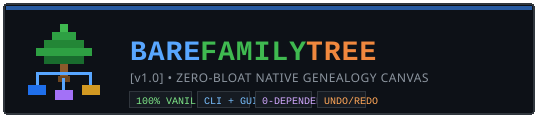
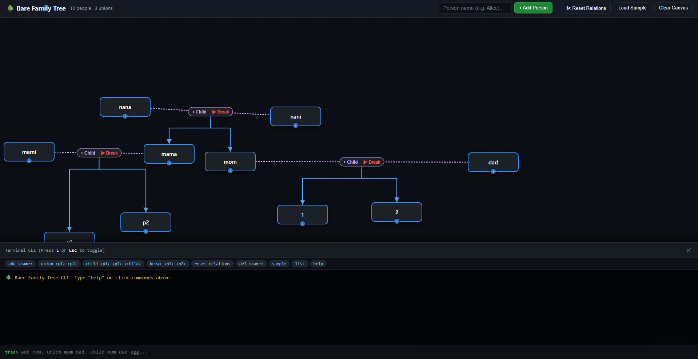
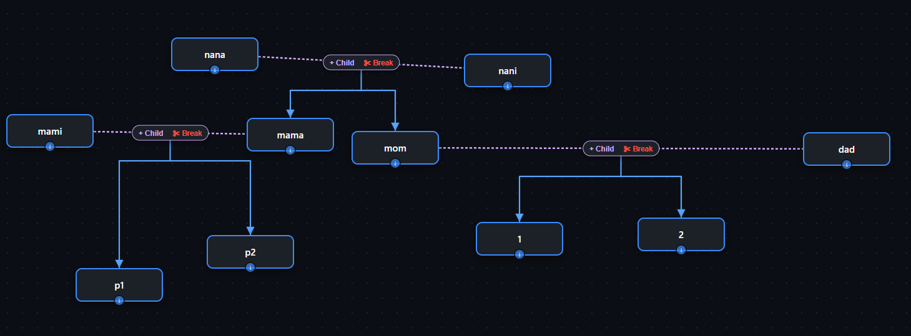

<p align="center">
  
</p>

<p align="center">
  <strong>A lightweight, zero-bloat interactive family tree canvas and CLI.</strong><br>
  Built with 100% vanilla web primitives. No bundlers, no frameworks, zero runtime dependencies.
</p>

<p align="center">
  
  
  
  
</p>

---

## 📸 Overview

Bare Family Tree gives you an open, unconstrained visual canvas for mapping genealogy, unions, and multi-generational lineages, paired with an integrated terminal CLI for lightning-fast keyboard-driven building.

### Full Interface & Terminal CLI


### Multi-Generational Canvas & Unions


---

## ✨ Features
 
- **Dual Mode (GUI + CLI)**:
  - **Visual Canvas**: Drag-and-drop people anywhere, connect spouses with drag handles, branch children instantly.
  - **Embedded Terminal**: Press <kbd>E</kbd> to open an interactive terminal with command suggestions and chips.
- **Real-Time SVG Graph**: Auto-routing marriage connectors, union center badges, and hierarchical child arrows. 
- **Direct Card Manipulation**: Inline renaming, drag-to-partner, one-click child addition, and union disconnection (<kbd>✂ Break</kbd>).

---

## 🚀 Quick Start

No installation or compilation needed.

### 1. Run in Browser
Open `index.html` directly in any modern browser:
```bash
# Double click index.html or launch via static server:
npx serve .
# or Python:
python -m http.server 8000
```

### 2. Run Tests
The test suite runs using Node.js's native test runner (zero test dependencies):
```bash
node --test test/tree.test.js
```

---

## ⌨️ CLI Commands & Shortcuts

Press <kbd>E</kbd> or <kbd>Esc</kbd> anywhere on the page to toggle the terminal drawer.

| Command | Description | Example |
| :--- | :--- | :--- |
| `add <name>` | Create a person card on canvas | `add Alice` |
| `union <p1> <p2>` | Form a marriage/partner union between two people | `union Alice Bob` |
| `child <p1> <p2> <child>` | Attach a child under two parents | `child Alice Bob Charlie` |
| `break <p1> <p2>` | Sever union without deleting the people | `break Alice Bob` |
| `del <name>` | Remove a person and re-route affected links | `del Charlie` |
| `reset-relations` | Clear all unions and parent-child edges (keeps people) | `reset-relations` |
| `undo` / `redo` | Step backward or forward through history | `undo` |
| `sample` | Load an example multi-generational lineage | `sample` |
| `list` | Print all current members and unions to CLI log | `list` |

### Keyboard Shortcuts
- <kbd>E</kbd> / <kbd>Esc</kbd> — Toggle terminal CLI drawer
- <kbd>Ctrl</kbd> + <kbd>Z</kbd> — Undo
- <kbd>Ctrl</kbd> + <kbd>Y</kbd> — Redo

---

## 🏛️ Architecture & Data Model

Designed strictly around minimal primitive structures:

- **`FamilyTree` (`core/tree.js`)**:
  - `people`: `Map<string, { id, name, x, y }>`
  - `unions`: `Array<{ id, p1, p2, children: string[] }>`
- **`HistoryTracker`**: Pure snapshot-based undo/redo stack.
- **DOM & SVG (`app.js`)**: Native draggable DOM nodes overlaid on an SVG line layer.

---

## 📄 License

MIT © 2026 Bare Family Tree
